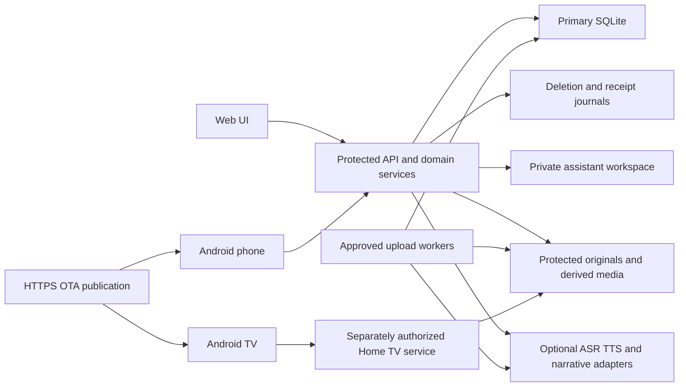
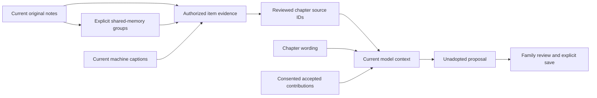

# Architecture

The [public monorepo is the development home](REPOSITORY_TRANSITION.md).
Legacy application histories and private operator configuration remain outside
its source lifecycle. Optional inference providers retain separate installations.

The [model/provider architecture](MODEL_PROVIDER_ARCHITECTURE.md) maps captions,
speech, narrative, face detection/recognition and embeddings to source adapters
and isolated inference runtimes. The offline catalog is descriptive; it does not
load weights or select a live deployment. New embedding spaces require versioned
artifacts and explicit comparison/reindex qualification.

## System map and ownership

The protected server is a modular application with separate worker/provider
processes. It owns library authorization, revisions and accepted mutations;
clients own capture, playback and presentation. [Project status](PROJECT_STATUS.md)
records the dated installation; a diagram is not an activation inventory.



Home TV publication/allow-list rules are a separate access path. The current
Android home/catalog and OTA clients require HTTPS; a local network does not
remove that transport contract or grant protected library access.

| State | Ownership and lifecycle |
| --- | --- |
| Primary SQLite | Accounts/libraries, asset metadata, approval/tasks, original contributions and revisioned stories/memoirs; explicit Alembic admission/migration |
| Family raw text/audio | Original text and bounded audio BLOBs remain distinct from transcripts, polished wording and tags; keep until authorized deletion/withdrawal, not assistant expiry |
| Original media | Runtime filesystem roots; no photos/videos in source Git |
| Derived media/vector/index state | Versioned preview/video/vector artifacts, claims and publication closure; output existence alone does not imply visibility |
| Original-deletion journal | Separate durable ledger/namespace and restore replay; matched backup prevents restored primary data from bypassing withdrawn access |
| Assistant receipt journal | Recognized input/processing status, 30-day expiry; transient assistant recordings are not retained |
| Private assistant workspace | Separate validated schema-v2 SQLite store, owned threads/preferences/request context, 30-day exchange expiry; independent of primary Alembic and troubleshooting receipts |
| Models and OTA | External runtime model installations/licenses; separately signed APKs and immutable HTTPS channel artifacts |

Main entry points are `server/backend/app/main.py` (closed application factory),
`server/backend/app/access/runtime.py` (explicit existing-store/provider admission),
`server/backend/app/access/` (protected domain contracts) and
`clients/android/android/` (shared Kotlin and Compose clients). The Web UI lives
with the server. [Server](../server/README.md), [Android](../clients/android/README.md),
[model providers](MODEL_PROVIDER_ARCHITECTURE.md) and [operations](OPERATIONS.md)
map their development and runtime boundaries.

The [family memory hub direction](FAMILY_MEMORY_HUB.md) extends current stories
and memoirs with long oral-history projects, people/event relationships and
reviewed multiple-speaker chapters. It is a design direction requiring additive
contracts; current short recording/storage limits do not support unlimited sessions.

## Conversational viewing

The [fluid assistant design](ASSISTANT_FLUID_EXPERIENCE.md) uses the protected
backend as the authority for context and typed read-only actions. New clients
explicitly negotiate action results over fresh source cohorts; private persisted
replies remain generic, and recovered/history exchanges remain inert. Web and
phone own visible state, capture, playback and lifecycle cancellation.
Continuous source reading, latency measurement and speaking interruption have
separate acceptance stages; the current pipeline remains half duplex.

## Product concepts

A **library** is an access boundary. An **album** is a deliberate collection of media. A **memory** is an original contribution, in text or audio, from a family member. A **story** is an editable, revisioned narrative with chapters and media selection. A **memory book** organizes related chapters for a longer reading experience.

Originals, transcripts, polished text, tags and chapter links remain distinct. Linking a memory into a chapter does not delete or rewrite the contribution. Removing the link preserves its original.

## Reviewed story evidence



[Chapter source choices](CHAPTER_SOURCE_CHOICES.md) are an explicit stored
policy in existing story content, independent of memory-group activation. A
policy-marked story uses only current, digest-matching IDs selected for each
chapter; a legacy story keeps its original context behavior until reviewed.
Original shared notes keep one canonical ID and byline, even when used by
several frames. Editorial wording and accepted contributions retain their own
labels and consent rules. A source choice does not verify a factual claim.

Default HTTP response shapes stay compatible with strict older clients. New
clients probe protected source capabilities and use an explicit query profile
for policy reads/saves/title suggestions. Current membership, every selected
asset, original note identity and source revisions are rechecked in one snapshot.
Model I/O holds no database transaction; changed dependencies discard its
output before adoption. This adds no schema, automatic listening, background
source copying or anonymous TV access.

[New story chapter arrangement](STORY_CHAPTER_ARRANGEMENT.md) operates on the
reviewed create profile: split and merge preserve the selected media order,
current evidence eligibility and original contributions. Manual partitions are
frozen into save retries and sent to title assistance. Legacy create grouping
and saved-story media grouping remain unchanged. Source refresh retains a valid
manual layout and words while renewing its evidence snapshot in both clients.
The [Web recovery flow](WEB_STORY_SOURCE_REFRESH.md) preserves mounted text
controls during the pending read and requires a new source-review confirmation.

[Phone reading continuity](PHONE_STORY_READING_CONTINUITY.md) stores only
Keystore-encrypted location metadata, separately from conversation or story
content. A fresh authorized read must match the exact account, library, story
revision, chapter and asset before offering an explicit resume. Automatic preview
loads do not create a pointer. Current denial and logout clear only the matching
account; stale work cannot erase a replacement account's positions.

[Memoir reading continuity](PHONE_MEMOIR_READING_CONTINUITY.md) extends the
location contract to a book and its ordered child revisions. Metadata-only
parent/child reads precede an offer; explicit Continue reauthorizes both again.
Story and memoir records use fixed, separate encryption domains, with the
existing story envelope retained for compatibility. Original media and speech
remain independent user actions.

[Next-chapter narration](MEMOIR_NARRATION_CONTINUATION.md) is a transient,
single-use user intent rather than an automatic playlist. Source and destination
snapshots bind exact adjacent chapters inside one story. Foreground, recording,
wording and access checks precede the one start attempt; refusal never causes
a later retry. Local speech completion alone does not navigate the reader.

[Phone album-to-story selection](PHONE_ALBUM_TO_STORY.md) reads the existing
protected album directory and rechecks a displayed album before atomically
seeding an unsaved editor. It preserves the complete album cohort for bounded
media browsing, while an outline uses only the user's reviewed selection.
Albums do not supply copied source choices, descriptions or prose. The preview
and final story save reauthorize their own actual media and evidence snapshots.

Web shelf actions also bind their rendered card/list/book identity. That guard
is passed through protected detail reads, including authorization-failure
cleanup, so a same-library refresh cannot let an obsolete response erase the
replacement reader's conversation-selection hint.

## Ownership

| Module | Responsibility |
|---|---|
| Server API | Authentication, membership, upload receipt, stories, memories, assistant contracts and provenance |
| Web | Organizing, review, browser recording, immersive story reading and visible progress |
| Android phone | Capture, upload, reviewed voice input, conversation, protected reading and OTA client |
| Android TV | Remote-friendly library selection, large-screen viewing and paced playback |
| Workers | Bounded derived media and model processing; explicit queue state and resource limits |
| Operator tools | Backups, migration, qualification, release and recovery; separate from product flows |

## Schema and release boundaries

An installed source head does not establish the live Alembic revision. Optional
features check their actual schema and remain off until separately activated.
The [memory schema guard](../server/docs/security/MEMORY_GROUP_SCHEMA_APPLICATION.md)
requires an explicit reviewed a0/b1/c2/d1 starting revision, a separate matching
private offline backup and independently stopped writers. It adds only the
pending tables/indexes/triggers through e7, preserving all old rows and schema
objects under one exclusive transaction. API and companion workers must be
qualified and switched together before writers resume. Generated qualification
is separate from a live stopped-writer backup and from phone/device acceptance.

## Visual discovery provenance

Image similarity has an optional immutable vector-record contract and a
protected library-scoped reader. Authorization and the complete bounded cohort
are resolved in one SQLite snapshot before file access; source and exact model/
preprocessing identity, file and component checksums are required. The ranker returns IDs only; the group adapter hydrates protected asset fields
inside the same authorization snapshot. It never invokes a model or global index.
The vector tables still have no migration or live activation. A separate e7
migration adds ID-only memory groups; a default-off Web editor can link current
family notes and review capture-time plus similarity suggestions. Qualified
vector configuration is explicit, and manual groups work without vectors.
The optional [shared-story evidence adapter](SHARED_MEMORY_STORY_SOURCES.md)
rehydrates current group notes in the authorized story snapshot. Canonical note
IDs can support multiple media and chapters while the prompt contains one copy;
the source retains its original media and byline. Saved links contain IDs and
digests, and provider jobs recheck current group/media/source dependencies.
The phone uses the same protected contract behind its own default-off build
choice. Its editor and bounded preview cache belong to the current account,
library and visible-item generation; no private draft is persisted or sent to
anonymous Home/TV. See [phone groups](PHONE_MEMORY_GROUPS.md). See
[the group contract](../server/docs/security/MEMORY_GROUPS_V1.md). An internal image-worker producer now binds the publication journal to
the exact approved task and verified profile. Ready record, task completion and
committed intent are atomic; restart can recover a verified file before loading
a provider. The default worker path remains unchanged, with no CLI activation.
The producer, guarded journal and all-version cleanup planner use synthetic
fixtures. Installed producer identity, native filesystem recovery and durable
asset-deletion replay must be qualified before activation. See
[activity grouping](ACTIVITY_GROUPING_DESIGN.md).

The [asset-withdrawal lifecycle](ASSET_WITHDRAWAL_LIFECYCLE.md) adds an explicit
V3 external journal capability. Exact source/library bindings survive primary
rollback and offline restore replay; replay marks the retained parent deleted.
Receipt-bound vector cleanup planning checks independently committed primary
state. The optional [vector-erasure coordinator](VECTOR_ERASURE_LIFECYCLE.md)
adds a durable primary manifest and no-overwrite quarantine claims for completed
and interrupted publications. Its optional private independent catalog preserves
the known file closure and restores matching missing immutable records after
withdrawal replay into an older primary, with atomic refusal on conflicts.
Original media, contributions and immutable records remain retained. The three
generated executor/catalog cases passed bounded native Windows qualification at
`b8f103b`; installed producer recovery, independent catalog backup coverage,
power-loss durability and live capability switching remain separate gates.

The isolated image worker now verifies checkpoint bytes around model loading
and inference, observes the supported evaluation transform configuration, and
requires probe/embed receipt consistency. Package versions and current source
digests are snapshot evidence; they do not independently prove installed
provider code provenance. Legacy embedding rows retain their existing schema.
The internal producer writes that exact identity into its immutable record.
Native provider/filesystem qualification remains a separate delivery gate.

## Voice pipeline

Two entry paths share protected ASR/intent/speech contracts:

```text
ordinary dictation: capture → stop → ASR → review/edit → insert → explicit Send
opt-in foreground voice: Start → capture/endpoint → ASR → read-only turn
                         → visible reply/action → successful playback → listen
                         Pause/End, uncertainty or lifecycle loss → stop
```

The explicit Start authorizes the bounded foreground read-only loop. Capture
stops during requests and playback; the next listen depends on actual successful
audio completion. It is half duplex, with no background microphone, streaming
speech or speech barge-in. Ordinary dictation still requires transcript review
and submission. Memory edits, permissions and original deletion need their
separate explicit workflow. Receipt/status history is distinct from personal
conversation context and from family source recordings.

The [Web assistant](ASSISTANT_TRANSCRIPT_REVIEW.md) and
[phone assistant's transcript review](../clients/android/docs/ANDROID_ASSISTANT_TRANSCRIPT_REVIEW_2026-10-10.md)
preserve typed text while ASR completes. Only explicit Add accepts the exact
current reviewed transcript and its successful receipt into the editable command draft.
Discard clears that link. Recording, recognition and review block Send until
the user resolves the pending input; overflow preserves both texts.

Assistant result decoding accepts the server's capture-only seven-field asset
form and the optional date-hint extension. Filename and received-date labels
remain distinct from capture metadata; library-scoped thumbnail and open-effect
validation stay strict. See [result compatibility](ASSISTANT_RESULT_COMPATIBILITY.md).

Phone story/memoir [history navigation](PHONE_MEMORY_CHAT_NAVIGATION.md) binds the
rendered reader/thread/page and the visible control's lifetime. History reads
preserve the composer and never start another voice or submitted turn.

[Full-conversation continuation](MEMORY_CHAT_CONTINUATION.md) treats the
128-turn refusal separately from temporary rate limiting. An explicit action
creates a new conversation using one retained request identity. The clients
verify its directory and initial history before replacing the active thread,
then place retained words in the editable composer. Old history remains
available, and a separate Send is still required. Failed creation or readback
keeps the same retry identity and the old thread.

The [phone memoir composer](PHONE_MEMOIR_COMPOSITION.md) collects authorized
saved stories in a user-reviewed order. Opening requires fresh collection
permission; selecting and saving reauthorize each story and preserve its exact
revision, selection fingerprint and source policy. An uncertain save freezes
one immutable mutation. Its process-only draft is cleared on scope changes or
explicit departure. Optional introduction voice input has an independent transient
helper, created only by the explicit dictation action. Its account/library/shelf/
composer-epoch fence also applies before microphone capture and after ASR.
Reviewed words append to the latest accepted introduction only on Add; unresolved
voice input blocks Save. The helper is never a retained family-audio attachment.
Saved-book editing adds the rendered parent ID/revision and reader request to
that scope. A fresh parent grants edit permission independently of collection
creation permission; every child is reauthorized before the draft is populated.
The first update rechecks the reviewed parent and child snapshots. An uncertain
update replays the same book ID, base revision and mutation without refetching a
possibly superseded parent. Conflicts retain the transient draft for review.
Unfinished reader work blocks entry, and detached reader actions are inert while
the composer overlays it. A verified new or edited book is opened through a
fresh protected parent read; the shelf replaces the edited revision in place.
Child content loads only after explicit selection.

The phone memoir shelf displays opening excerpts and protected cover thumbnails
for at most eight books on the current page. Sequential cover reads use the
existing library-scoped thumbnail route, never original media or child-story
bodies. Each response is bounded to 512 KiB; decoded decorative images also have
pixel and dimension limits. Cover bytes are process-local and wiped on reader
entry, composition, departure, session/library replacement and backgrounding.
Only an explicit retry reloads missing covers; ready covers remain retained for
that same shelf scope. Card actions bind both the current shelf and their
rendered lifetime. These discovery previews neither create a reading position
nor start speech or model work.

[Web memoir introduction dictation](MEMOIR_INTRODUCTION_DICTATION.md) keeps its
textarea mounted while recognition runs. Availability, capture, stop, review,
insert and save remain distinct actions. Its helper binds the exact editable
form, current book revision and membership; abort/late-result fences discard
obsolete audio and text without touching a replacement helper. Typed words
survive recognition, overflow and discard. A shared microphone reservation prevents
chapter, assistant, original-note and memoir capture from opening overlapping
streams; obsolete reservations release only their own handle. This saves
introduction text only.

[Memoir opening narration](MEMOIR_INTRODUCTION_NARRATION.md) reads the saved
opening only after an explicit action. Its local voice uses the saved book
language; the exact book revision, ordered children and reader location bind
every control and completion. Navigation stops the old speech without moving
the reading position. It shares audio ownership with chapter/companion speech
and recording, and introduces no provider call, retained audio or route. Phone
manual start/resume actions bind the current controller, enabled state, resumed
lifecycle and rendered phase; phase changes replace the action node so a delayed
Pause cannot start speech. Active cleanup controls remain available.

[Chapter dictation](STORY_CHAPTER_DICTATION.md) uses the same protected ASR
adapter with a different destination. Explicit Add appends reviewed words to the
current chapter draft; it neither submits an assistant command nor saves the
story. The session binds the editor, chapter, ordered media and current account.
It preserves text typed while recognition completes, and an over-limit Add
retains both texts. A saved-story editor additionally binds the story revision.
The transient recording is distinct from an original family audio contribution,
which has its own retention, attribution and playback contract.

The [saved phone story editor](PHONE_SAVED_STORY_EDITING.md) reads fresh detail
and a complete same-revision contribution-reference map before seeding its
draft. Updates freeze the story ID, base revision, wording and link profile.
Conflict reload keeps the old draft until a valid replacement arrives; it cannot
accept a revision below the edit base. Idempotent retries may return a later
family revision, which is shown as the current saved version after strict
identity and revision checks. This adds no new backend route or schema.

Web recording startup is bound to the current account/library and view attempt.
A delayed microphone permission result stops its tracks before creating an
audio context when that scope has changed. Context startup and completion
also recheck ownership before exposing a recording or submitting audio. An
abort signal releases capture resources while startup is still unresolved;
late completion cannot restart capture. Permission wait and active recording
have distinct visible states. See the [recording lifecycle](WEB_RECORDING_LIFECYCLE.md).

The Web [recent-turn list](ASSISTANT_TURN_TRAIL.md) keeps eight successful
exchanges in page memory. It supplies no hidden chat history to the model;
explicit subsequent commands retain the existing bounded structured context.
Client clearing and server troubleshooting retention are separate lifecycles.

| Step | Where it happens |
|---|---|
| Capture and transcript review | Web browser or Android phone. Ordinary dictation is reviewed; the approved explicit foreground voice session sends read-only requests until Pause/End. |
| Assistant transcription | Authenticated server adapter calls the configured local ASR service; assistant audio is transient. |
| Intent, context and permitted action | Server assistant contracts, current membership and explicit action validation. |
| Story proposal or writing companion | Optional local model adapter and bounded worker; qualification is required before enabling generation. |
| Spoken assistant reply | Configured server speech adapter generates audio. v1 reads result counts; optional private reply speech reads the server-owned completed reply. Actual playback completion admits another capture, with unsupported requests pausing for review. The Windows adapter uses System.Speech. |
| Chapter read-aloud | Android TextToSpeech or browser speech synthesis, with explicit playback controls; installed voices determine availability. |

Changing a model endpoint does not authorize it to perform arbitrary actions.
Assistant commands, chapter proposals and accepted family memories have separate
contracts. A generated proposal requires review before it replaces saved wording.

## Retention and provenance

Original family notes are kept until an authorized owner deletes them. Text,
raw audio, derived transcript and polished wording remain distinguishable.
Assistant troubleshooting records keep recognized text, submitted commands and
processing status for thirty days; they do not retain assistant recordings.

[Voice reliability](ASSISTANT_VOICE_RELIABILITY.md) adds an internal exact-ID
lookup in the authorized discovery snapshot, safe ASR error codes and separate
terminal playback events. Singleton lookup contexts retain the existing opaque
fingerprint shape; recovery rehydrates current authorized cards without replaying
navigation. Player events extend the journal event table rather than its strict
legacy receipt envelope. The optional response header admits reporting only on
servers that implement the new endpoint; absent reports remain unknown.
Original deletion uses an external journal and verified recovery procedure.
Operators must preserve that journal when restoring or changing a deployment.

The default-off [D1 family-note erasure contract](../server/docs/security/FAMILY_NOTE_ERASURE_V2.md)
uses immutable note identity and recorded library lineage. Permanent erasure
requires current owner rights in every historical scope and a version 2 journal
append before secure primary deletion. It removes dependent generated editions
and AI payloads while preserving independent original memories and manually
saved story text. Ordinary story soft removal still retains history. The additive
migration does not adopt old unbound notes, and startup never upgrades a journal.

TV library publication is a separate contract. Private stories and recordings
are not automatically added to an anonymous LAN catalog.

## Choosing media for a story

The [related-media contract](../server/docs/security/STORY_RELATED_MEDIA_V1.md)
supports an explicit, read-only search inside the current library. It suggests
photos and videos sharing a selected item's recorded capture calendar day.
It reads catalog metadata after membership checks; it does not load images,
compare embeddings, run a model or create a story.

Web and phone selections use the same ordered limit of 24 items. Each candidate
requires the user's choice before the ordinary story preview reloads current
evidence. The phone keeps candidate pages and preview bytes bounded, and clears
them when selection or access changes. Filename dates and receipt dates remain
separate hints and cannot establish that two items depict the same activity.
Activity grouping and coherent prose generation remain subsequent, separately
qualified capabilities.

## Media pipeline

```text
original → approval/library assignment → safe probe/thumbnail/keyframes
         → optional embedding/caption → derived preview/playback export
         → independent verification → protected publication
```

Conversion readiness, copied files and published playback are separate states. Resume unfinished work from checkpoints; do not re-encode completed videos. Empty files and metadata sidecars cannot yield a video. Damaged sources need a verified backup or a separately reviewed salvage copy.

## Reading context and conversation

The search assistant's temporary exchange list retains eight successful Web
turns and forty phone turns. These are client process state, separate from
persisted story/memoir threads and thirty-day server troubleshooting records.
Client-local row/request identities are presentation keys; they are not trusted
server correlation or extra model history. New content follows the end only
when the user is already reading there; older reading positions and explicit
jump controls are described in [the Web trail contract](ASSISTANT_TURN_TRAIL.md).
Phone recognition keeps explicit transcript review before insertion or send.

The memoir editor treats the title, opening note and ordered-story form as a
stable draft surface. Asynchronous citation loading replaces only the citation
panel, so it does not replace focused inputs or interrupt composition. A result
must still match the current library, memoir revision, ordered children and
attached editor. Original-source inspection and playback remain explicit actions.

The Web memoir reader can prepare a question about its currently loaded chapter.
It supplies only matching book/story revisions, chapter identity and bounded
titles. It adds no narration or original contribution to that preparation and
keeps the conversation attached to the whole memoir. The user reviews and sends
through existing controls; server source checks still run at submission and
processing. A loaded chapter is a reading position, not a new permission scope.

Original memoir navigation retains a separate rendered-state binding. The
phone binding includes account/access generation, library, reader instance,
book and ordered child revisions, chapter, frame page and selected media. It
is checked before navigation and again after a deferred leave confirmation.
The collapsed contents panel renders loaded summaries/current chapters only;
an explicit child choice still uses the existing authorized metadata path.
Web media controls additionally require their DOM attachment and rendered
story/chapter to match before opening media or handling preview failures.

The [conversation navigation hint](CONVERSATION_NAVIGATION.md) is client process
state, separate from server conversation history and pending submission receipts.
It stores at most 16 conversation IDs with account, library, membership and
target revision bindings. Memoirs also bind ordered child story revisions.
Reopening reads the authorized directory and current messages before reporting
restoration. It clears composition and cannot replay a mutation. The hint does
not survive a client restart or grant access to an omitted conversation.

The [clarification cue](CONVERSATION_CLARIFICATION.md) is a passive presentation
of a ready, current story or memoir reply. Both clients require valid bounded
reply metadata before presenting the cue. A suggested follow-up prepares an
editable draft only when existing draft, dictation and pending-send guards allow
it. No cue starts recording, submits a message or applies a proposal.


## Approved central assistant and foreground session

[拾光助手](PERSONAL_ASSISTANT.md) is the shared phone/Web entry for conversational
retrieval. The Android pure `VoiceSessionController` binds callbacks to account,
library, app generation, session and operation. Its platform adapter owns a single
microphone/player; sample-based endpointing retains no PCM. Actual playback
completion, rather than synthesis/download success, admits the next capture.
Pause/End/background/audio-focus loss invalidate outstanding progression. An
uncertain submitted request remains available for receipt inspection, with no
automatic resubmission. Idle voice controls do not cancel manual requests.

The [voice presence UI](ASSISTANT_VOICE_PRESENCE.md) keeps phase transitions
separate from platform start observations. Phone recorder/player callbacks and
Web capture/player readiness determine when the UI can say it is listening or
speaking. Stale callbacks cannot change the current account/library session's
status. These observations grant no permission and do not admit the next turn.

The initial adapter used the protected v1 ASR/search/result-count TTS services.
The local [grounded result narration](ASSISTANT_VOICE_RELIABILITY.md#grounded-result-narration)
source now describes at most three current ordered cards, using only their kind
and validated recorded `taken_at` date. Strict contextual follow-ups preserve
the current selection; missing context requests a search first. Stateless speech
rechecks membership and source context after synthesis before returning audio.
The v1 envelope remains unchanged. Empty, clarifying and unsupported replies
still pause and remain visible on that path. The optional private reply speech
path below broadens that spoken interaction. Typed tools,
owned durable conversations/preferences and grounded local understanding are
separate backend layers. Personal thread storage must be deliberately initialized
and admitted, distinct from audit receipts and family story/audio storage. Existing
installed v1 clients continue to use their strict contracts.

A single explicit Start authorizes only this foreground read-only session.
Ordinary dictation remains capture → review → insert → send. The local providers,
models, GPU admission and transport trust remain Windows runtime configuration;
source builds do not discover or activate them.

## Private assistant workspace API

The default-off `/assistant/workspace/v1` API sits beside strict v1 retrieval.
Identity comes from the current authenticated library principal; library owners
receive no override for a member's private history. An optional canonical
`assistant_workspace_path` flows through staging/runtime configuration into an
existing validated store. Missing, malformed, overlapping or aliased paths refuse
without creating a database. Provisioning is an explicit separate operation.

The API exposes capabilities, owned thread list/create/read/delete and own
preference read/update/reset. Mutations require current revisions; bodies have a
2 KiB cap and three-second read deadline, strict framing and duplicate/unknown
field rejection. Startup and hourly pruning enforce fixed 30-day exchange
retention; failed maintenance closes the optional surface until recovery.

History projects owned text, timestamps and non-actionable card type/count
placeholders. It does not project source IDs/bindings, receipt IDs or saved
authority as a ready action. Clients cannot upload fabricated assistant replies
or arbitrary reference sets.

[Server-owned turns and continuation](PRIVATE_ASSISTANT_TURNS_V1.md) add an
isolated schema-v2 request ledger and revision-bound context. A bounded lease
reserves the revision before computation. Completion commits the exchange,
summary and context atomically; identical retries read the existing request.
GET recovery rehydrates results against current membership and source bindings,
and never replays navigation. The receipt journal is separate: a failure to
finalize a receipt cannot regenerate an already committed exchange.

The Web controller keeps draft text and an exact pending request identity in
process memory. [History navigation](PRIVATE_ASSISTANT_HISTORY_V1.md) shows up to 20 recent
complete exchanges under a 240 KiB JSON budget, with explicit older pages pinned
to the same thread revision. Opted-in list labels derive from the first
unexpired question and add no stored copy. History is independently available
when discovery is down; paging never changes trusted context, receipts or voice
consent. Clients reject mixed snapshots and preserve drafts on an explicit reload. Phone uses a separately scoped coordinator and private
conversation panel; account/library/generation changes and backgrounding clear
its private buffers. [Phone private voice/text continuation](PRIVATE_ASSISTANT_VOICE_V1.md)
uses an explicitly activated owned thread: “继续聊天” enters typed conversation
without capture, while “在这个对话中语音聊” starts the approved foreground
listen/reply/listen driver. One synchronous request identity and an optional
confirmed ASR parent join the private ledger to actual receipt metadata. The
ordinary v1 route remains when no private conversation is selected; a stale or
deleted selection never silently falls back. Capability loss stops capture,
and access denial clears protected caches. A saved reference
never grants access and a recovered reply never opens media automatically.

The first applied preference is the language of a grounded textual reply.
Response length and voice pace remain unsupported presentation preferences;
they do not configure ASR/TTS or select providers. Capability checks expose this
distinction. Schema-v2 initialization or the explicit offline v1 upgrade is a
separate operation; opening a store never creates or migrates it. New checkouts
remain default-off. The v58 installation has explicitly configured workspace
storage and prior native admission evidence; see [current status](PROJECT_STATUS.md).

[Native qualification](PRIVATE_ASSISTANT_NATIVE_QUALIFICATION.md) must use the
service's execution identity. In particular, an interactive-user private-store
ACL is not accepted automatically by a SYSTEM API. The synthetic Windows child
loads application dependencies after its Job admission; real store provisioning
and live activation remain separate operations.

## Optional private reply speech

[Protected reply speech](PRIVATE_ASSISTANT_REPLY_SPEECH_V1.md) reads an exact
completed owned turn. A separate default-off runtime flag requires healthy
workspace/journal stores and an existing local TTS adapter. The caller sends
only library, expected revision and distinct turn/speech request IDs. The server
validates current membership, source context and a successful parent journal
record, derives voice language from saved text, and rechecks authority after
synthesis. Each speech ID is admitted once; no audio or duplicate reply text is
retained in the journal. Replies exceeding 600 UTF-8 bytes remain visible.

The foreground phone/Web loop may speak a fresh result, empty result or
clarification, then listen after actual audio completion. Unsupported requests
speak help and pause for review. Recovery never triggers speech or navigation.
Client scope/cancellation fences discard late audio. The v58 installation enables
this optional flag with separately qualified storage/providers; a new checkout
does not activate them. When the capability is
absent, clients retain the v1 result-speech path; its content depends on the
deployed server revision. Local narration checks do not establish native TTS
quality, delivery or physical-device acceptance.

## Saved memory retrieval foundation

`assistant_memory_discovery.py` is an internal, read-only service over the
existing authorized saved-story and memoir readers. Literal, case-insensitive
queries match saved titles, chapter narration and memoir openings. It returns
up to 12 immutable references with a bounded excerpt, editorial revision and a
separate source revision. A memoir source revision binds its ordered current
child stories and their source snapshots; changing a child does not require an
artificial parent edit to invalidate the reference.

The scan refuses incomplete discovery above 256 combined candidates. Existing
domain readers filter inaccessible media before paging and reauthorize details;
duplicate identities or a concurrent database commit during the multi-page scan
refuse the result. The `data_version` guard detects drift across the readers'
separate transactions; it is not a persistent snapshot or permission to open a
later reference without revalidation.

An internal explicit-command parser and saved-memory tool now project transient
typed cards, an exact legacy history summary, and existing opaque story/memoir
references. The private-turn gateway exposes them only with explicit negotiation
and a separate default-off capability probe; the base capability response stays
compatible with existing clients. Fresh cards revalidate current sources before
completion and response. Replay keeps legacy summaries and inert placeholders;
saved-reference speech revalidates the matching completed exchange and every
current story/memoir source before and after synthesis. Web shows scoped immutable
text cards without media hydration. A separate optional speech probe enables
their short generic replies; original card and base probes remain compatible.
Late responses and audio are fenced on feature loss, and playback stops before
another foreground capture can start. Phone cards and explicit Web/phone reader navigation were delivered in v55.
A separate optional reader probe preserves search compatibility. The ordinal GET
resolves stored completed-turn references, revalidates current source digests and
owner/revision chains, and returns existing reader detail. Clients stop foreground
voice before a tap-triggered read and fence late handoffs by scope and fresh turn.
The earlier v55 delivery was pinned to `c65528a`; v58 retains this foundation. The
[saved-memory card contract](ASSISTANT_SAVED_MEMORY_CARDS_V1.md) requires separate
feature negotiation, current-source revalidation and explicit reader handoff.
Recovered history remains non-actionable. No inference, automatic story mutation
or background propagation is performed.


## Saved-memory conversational followups

The [followup contract](ASSISTANT_SAVED_MEMORY_FOLLOWUPS.md) adds a separate
optional probe and a request/revision parent anchor to existing opted-in turns.
Clients bind fresh displayed cards, regardless of typed, suggested or spoken
input. The server owns and rechecks the latest completed parent, rehydrates
current authorized source readers and returns the same ordered card grammar.
No client source context grants authority. Outline and original-excerpt views
remain bounded; history/recovery is generic and cannot restore actions.

This followup layer was developed after v55 and is included in v58. No provider, schema,
retention or story mutation is added. Draft suggestions end foreground voice;
explicit sends and reader opening keep their existing controls. Optional-probe
403 fallback rechecks the base capability, so older closed routes remain
compatible without ignoring a current authorization failure.


## Explicit saved-memory opening speech

The [opening-speech contract](ASSISTANT_SAVED_MEMORY_READING.md) adds a separate
optional capability and ordinal speech route. The server resolves current story
first-chapter narration or memoir introduction from stored canonical references,
without replaying a search or accepting caller text. All sources and parent
state are rechecked after local synthesis; selected saved wording stays transient.
The one-shot card action was delivered in v57 and is retained in v58. It ends
voice/capture before speech, fences the rendered parent and current scope, and
discards audio after cancellation or source/capability changes. Fresh-display
client guards complement server ownership checks; recovered history cannot
trigger playback. The private panel and central phone workspace share one player.


## Contextual voice actions in v58

The [fluid experience contract](ASSISTANT_FLUID_EXPERIENCE.md) adds explicitly
negotiated typed actions over a fresh completed result cohort. Spoken retrieval
may open a validated current ordinal or read a saved story/memoir opening; typed
requests present an explicit action control. Opening a reader ends foreground
voice. A successful opening playback can resume listening within an opted-in
session; failure/uncertainty pauses it. The spoken opening is bounded to 240
Unicode code points and 600 UTF-8 bytes. The separate manually started chapter
read-aloud reader has its own pause/resume behavior; it is not this assistant
opening loop. Assistant full-chapter continuation/progress remains roadmap work.

Parent revision/source bindings and current membership are rechecked; recovered
history cannot start speech/navigation. There is no general LLM tool executor,
automatic story mutation or permission change. The [v58 test guide](../clients/android/docs/PHONE_V58_TEST_GUIDE_ZH.md)
provides supported examples and retains physical-device acceptance as a separate gate.

## Release launcher qualification

A source-package smoke check and a compiled launcher are distinct from execution
of the deployed launcher's validation path. Before switching, validate the exact
manifest count, source hashes, configuration/dependency identity, accepted
delivery closure and read-only database schema through the actual launcher.
Normal and rollback receipts must match their pinned configurations, including
providers already enabled on the old release. The
[v57 recovery record](../clients/android/docs/PHONE_V57_RELEASE_2026-10-14.md)
documents the count/receipt correction and listener-free staging gate.
