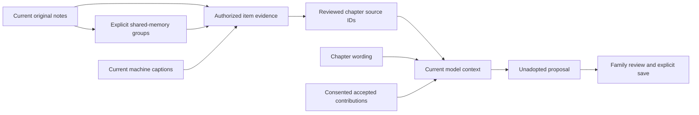

# Architecture

The [public monorepo is the development home](REPOSITORY_TRANSITION.md).
Legacy application histories and private operator configuration remain outside
its source lifecycle. Optional inference providers retain separate installations.

The [model/provider architecture](MODEL_PROVIDER_ARCHITECTURE.md) maps captions,
speech, narrative, face detection/recognition and embeddings to source adapters
and isolated inference runtimes. The offline catalog is descriptive; it does not
load weights or select a live deployment. New embedding spaces require versioned
artifacts and explicit comparison/reindex qualification.

## Product concepts

A **library** is an access boundary. An **album** is a deliberate collection of media. A **memory** is an original contribution, in text or audio, from a family member. A **story** is an editable, revisioned narrative with chapters and media selection. A **memory book** organizes related chapters for a longer reading experience.

Originals, transcripts, polished text, tags and chapter links remain distinct. Linking a memory into a chapter does not delete or rewrite the contribution. Removing the link preserves its original.

## Reviewed story evidence



[Chapter source choices](CHAPTER_SOURCE_CHOICES.md) are an explicit stored
policy in existing story content, independent of memory-group activation. A
policy-marked story uses only current, digest-matching IDs selected for each
chapter; a legacy story keeps its original context behavior until reviewed.
Original shared notes keep one canonical ID and byline, even when used by
several frames. Editorial wording and accepted contributions retain their own
labels and consent rules. A source choice does not verify a factual claim.

Default HTTP response shapes stay compatible with strict older clients. New
clients probe protected source capabilities and use an explicit query profile
for policy reads/saves/title suggestions. Current membership, every selected
asset, original note identity and source revisions are rechecked in one snapshot.
Model I/O holds no database transaction; changed dependencies discard its
output before adoption. This adds no schema, automatic listening, background
source copying or anonymous TV access.

## Ownership

| Module | Responsibility |
|---|---|
| Server API | Authentication, membership, upload receipt, stories, memories, assistant contracts and provenance |
| Web | Organizing, review, browser recording, immersive story reading and visible progress |
| Android phone | Capture, upload, reviewed voice input, conversation, protected reading and OTA client |
| Android TV | Remote-friendly library selection, large-screen viewing and paced playback |
| Workers | Bounded derived media and model processing; explicit queue state and resource limits |
| Operator tools | Backups, migration, qualification, release and recovery; separate from product flows |

## Schema and release boundaries

An installed source head does not establish the live Alembic revision. Optional
features check their actual schema and remain off until separately activated.
The [memory schema guard](../server/docs/security/MEMORY_GROUP_SCHEMA_APPLICATION.md)
requires an explicit reviewed a0/b1/c2/d1 starting revision, a separate matching
private offline backup and independently stopped writers. It adds only the
pending tables/indexes/triggers through e7, preserving all old rows and schema
objects under one exclusive transaction. API and companion workers must be
qualified and switched together before writers resume. Generated qualification
is separate from a live stopped-writer backup and from phone/device acceptance.

## Visual discovery provenance

Image similarity has an optional immutable vector-record contract and a
protected library-scoped reader. Authorization and the complete bounded cohort
are resolved in one SQLite snapshot before file access; source and exact model/
preprocessing identity, file and component checksums are required. The ranker returns IDs only; the group adapter hydrates protected asset fields
inside the same authorization snapshot. It never invokes a model or global index.
The vector tables still have no migration or live activation. A separate e7
migration adds ID-only memory groups; a default-off Web editor can link current
family notes and review capture-time plus similarity suggestions. Qualified
vector configuration is explicit, and manual groups work without vectors.
The optional [shared-story evidence adapter](SHARED_MEMORY_STORY_SOURCES.md)
rehydrates current group notes in the authorized story snapshot. Canonical note
IDs can support multiple media and chapters while the prompt contains one copy;
the source retains its original media and byline. Saved links contain IDs and
digests, and provider jobs recheck current group/media/source dependencies.
The phone uses the same protected contract behind its own default-off build
choice. Its editor and bounded preview cache belong to the current account,
library and visible-item generation; no private draft is persisted or sent to
anonymous Home/TV. See [phone groups](PHONE_MEMORY_GROUPS.md). See
[the group contract](../server/docs/security/MEMORY_GROUPS_V1.md). An internal image-worker producer now binds the publication journal to
the exact approved task and verified profile. Ready record, task completion and
committed intent are atomic; restart can recover a verified file before loading
a provider. The default worker path remains unchanged, with no CLI activation.
The producer, guarded journal and all-version cleanup planner use synthetic
fixtures. Installed producer identity, native filesystem recovery and durable
asset-deletion replay must be qualified before activation. See
[activity grouping](ACTIVITY_GROUPING_DESIGN.md).

The [asset-withdrawal lifecycle](ASSET_WITHDRAWAL_LIFECYCLE.md) adds an explicit
V3 external journal capability. Exact source/library bindings survive primary
rollback and offline restore replay; replay marks the retained parent deleted.
Receipt-bound vector cleanup planning checks independently committed primary
state. The optional [vector-erasure coordinator](VECTOR_ERASURE_LIFECYCLE.md)
adds a durable primary manifest and no-overwrite quarantine claims for completed
and interrupted publications. Its optional private independent catalog preserves
the known file closure and restores matching missing immutable records after
withdrawal replay into an older primary, with atomic refusal on conflicts.
Original media, contributions and immutable records remain retained. The three
generated executor/catalog cases passed bounded native Windows qualification at
`b8f103b`; installed producer recovery, independent catalog backup coverage,
power-loss durability and live capability switching remain separate gates.

The isolated image worker now verifies checkpoint bytes around model loading
and inference, observes the supported evaluation transform configuration, and
requires probe/embed receipt consistency. Package versions and current source
digests are snapshot evidence; they do not independently prove installed
provider code provenance. Legacy embedding rows retain their existing schema.
The internal producer writes that exact identity into its immutable record.
Native provider/filesystem qualification remains a separate delivery gate.

## Voice pipeline

```text
phone/browser: explicit capture → stop → review
server ASR adapter: transient audio → recognized text
client: edit → explicit submit
server: authenticated receipt → context/intent → allowed action or clarification
client: visible response → explicit speech request/playback
```

A local ASR/model adapter is configurable. Recognition is not a submitted command. Continuous conversation retains explicit turn boundaries; it does not imply continuous microphone capture. Every accepted action must have a receipt and processing state.

The [Web assistant](ASSISTANT_TRANSCRIPT_REVIEW.md) and
[phone assistant's transcript review](../clients/android/docs/ANDROID_ASSISTANT_TRANSCRIPT_REVIEW_2026-10-10.md)
preserve typed text while ASR completes. Only explicit Add accepts the exact
current reviewed transcript and its successful receipt into the editable command draft.
Discard clears that link. Recording, recognition and review block Send until
the user resolves the pending input; overflow preserves both texts.

[Chapter dictation](STORY_CHAPTER_DICTATION.md) uses the same protected ASR
adapter with a different destination. Explicit Add appends reviewed words to the
current chapter draft; it neither submits an assistant command nor saves the
story. The session binds the editor, chapter, ordered media and current account.
It preserves text typed while recognition completes, and an over-limit Add
retains both texts. A saved-story editor additionally binds the story revision.
The transient recording is distinct from an original family audio contribution,
which has its own retention, attribution and playback contract.

Web recording startup is bound to the current account/library and view attempt.
A delayed microphone permission result stops its tracks before creating an
audio context when that scope has changed. Context startup and completion
also recheck ownership before exposing a recording or submitting audio. An
abort signal releases capture resources while startup is still unresolved;
late completion cannot restart capture. Permission wait and active recording
have distinct visible states. See the [recording lifecycle](WEB_RECORDING_LIFECYCLE.md).

The Web [recent-turn list](ASSISTANT_TURN_TRAIL.md) keeps eight successful
exchanges in page memory. It supplies no hidden chat history to the model;
explicit subsequent commands retain the existing bounded structured context.
Client clearing and server troubleshooting retention are separate lifecycles.

| Step | Where it happens |
|---|---|
| Capture and transcript review | Web browser or Android phone; the user starts, stops and reviews. |
| Assistant transcription | Authenticated server adapter calls the configured local ASR service; assistant audio is transient. |
| Intent, context and permitted action | Server assistant contracts, current membership and explicit action validation. |
| Story proposal or writing companion | Optional local model adapter and bounded worker; qualification is required before enabling generation. |
| Spoken assistant reply | Configured server speech adapter generates audio; the client starts/stops playback explicitly. The Windows adapter uses System.Speech. |
| Chapter read-aloud | Android TextToSpeech or browser speech synthesis, with explicit playback controls; installed voices determine availability. |

Changing a model endpoint does not authorize it to perform arbitrary actions.
Assistant commands, chapter proposals and accepted family memories have separate
contracts. A generated proposal requires review before it replaces saved wording.

## Retention and provenance

Original family notes are kept until an authorized owner deletes them. Text,
raw audio, derived transcript and polished wording remain distinguishable.
Assistant troubleshooting records keep recognized text, submitted commands and
processing status for thirty days; they do not retain assistant recordings.
Original deletion uses an external journal and verified recovery procedure.
Operators must preserve that journal when restoring or changing a deployment.

The default-off [D1 family-note erasure contract](../server/docs/security/FAMILY_NOTE_ERASURE_V2.md)
uses immutable note identity and recorded library lineage. Permanent erasure
requires current owner rights in every historical scope and a version 2 journal
append before secure primary deletion. It removes dependent generated editions
and AI payloads while preserving independent original memories and manually
saved story text. Ordinary story soft removal still retains history. The additive
migration does not adopt old unbound notes, and startup never upgrades a journal.

TV library publication is a separate contract. Private stories and recordings
are not automatically added to an anonymous LAN catalog.

## Choosing media for a story

The [related-media contract](../server/docs/security/STORY_RELATED_MEDIA_V1.md)
supports an explicit, read-only search inside the current library. It suggests
photos and videos sharing a selected item's recorded capture calendar day.
It reads catalog metadata after membership checks; it does not load images,
compare embeddings, run a model or create a story.

Web and phone selections use the same ordered limit of 24 items. Each candidate
requires the user's choice before the ordinary story preview reloads current
evidence. The phone keeps candidate pages and preview bytes bounded, and clears
them when selection or access changes. Filename dates and receipt dates remain
separate hints and cannot establish that two items depict the same activity.
Activity grouping and coherent prose generation remain subsequent, separately
qualified capabilities.

## Media pipeline

```text
original → approval/library assignment → safe probe/thumbnail/keyframes
         → optional embedding/caption → derived preview/playback export
         → independent verification → protected publication
```

Conversion readiness, copied files and published playback are separate states. Resume unfinished work from checkpoints; do not re-encode completed videos. Empty files and metadata sidecars cannot yield a video. Damaged sources need a verified backup or a separately reviewed salvage copy.

## Reading context and conversation

The search assistant's temporary exchange list retains eight successful Web
turns and forty phone turns. These are client process state, separate from
persisted story/memoir threads and thirty-day server troubleshooting records.
Client-local row/request identities are presentation keys; they are not trusted
server correlation or extra model history. New content follows the end only
when the user is already reading there; older reading positions and explicit
jump controls are described in [the Web trail contract](ASSISTANT_TURN_TRAIL.md).
Phone recognition keeps explicit transcript review before insertion or send.

The memoir editor treats the title, opening note and ordered-story form as a
stable draft surface. Asynchronous citation loading replaces only the citation
panel, so it does not replace focused inputs or interrupt composition. A result
must still match the current library, memoir revision, ordered children and
attached editor. Original-source inspection and playback remain explicit actions.

The Web memoir reader can prepare a question about its currently loaded chapter.
It supplies only matching book/story revisions, chapter identity and bounded
titles. It adds no narration or original contribution to that preparation and
keeps the conversation attached to the whole memoir. The user reviews and sends
through existing controls; server source checks still run at submission and
processing. A loaded chapter is a reading position, not a new permission scope.

The [conversation navigation hint](CONVERSATION_NAVIGATION.md) is client process
state, separate from server conversation history and pending submission receipts.
It stores at most 16 conversation IDs with account, library, membership and
target revision bindings. Memoirs also bind ordered child story revisions.
Reopening reads the authorized directory and current messages before reporting
restoration. It clears composition and cannot replay a mutation. The hint does
not survive a client restart or grant access to an omitted conversation.

The [clarification cue](CONVERSATION_CLARIFICATION.md) is a passive presentation
of a ready, current story or memoir reply. Both clients require valid bounded
reply metadata before presenting the cue. A suggested follow-up prepares an
editable draft only when existing draft, dictation and pending-send guards allow
it. No cue starts recording, submits a message or applies a proposal.
