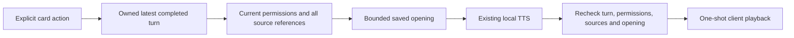

# Explicit saved-memory opening speech

Status: delivered in API/Web source 4b69844 and phone v57; see the
[release record](../clients/android/docs/PHONE_V57_RELEASE_2026-10-14.md).
Source, package, Windows runtime and HTTPS publication checks are complete.
Physical owner/member and listening acceptance remain separate.

## What will be read

A fresh saved-memory card offers an explicit “朗读开篇 / Read opening”
action. It reads the first saved story chapter's narration or a saved memoir's
introduction, using the exact saved wording bounded to 240 Unicode code points and
600 UTF-8 bytes. It is not necessarily the search-match excerpt displayed on the
card. Empty or malformed openings are unavailable; the server does not replace
them with a title or generate new text.

Saved narration may be edited or derived prose; this action reads that saved
opening, rather than the original family recording. It does not rewrite it.

This client action is one-shot playback. It ends foreground voice and pending
manual microphone capture before requesting audio, shows preparing/playing
states, and exposes Stop. It never restarts listening automatically. Foreground voice-requested narration is
a later separate slice; the existing v56 followup parser does not imply it.

## Protected server contract

A separate optional probe returns exactly `{version: 1, available: <boolean>}`:
`GET /assistant/workspace/v1/saved-memory-reading-capabilities?library_id=...`.
It requires current workspace, saved-card, authorized memory reader and existing
reply-speech health. No new base capability fields or runtime flag are added.
Web and phone handle old unknown-route 403 by rechecking the existing base
capability, as the followup probe does; real authorization failures remain fatal.

The new route is:

`POST /assistant/workspace/v1/threads/{thread_id}/requests/{turn_id}/memory-cards/{ordinal}/speech`

Its exact body is `{library_id, expected_revision}`. The zero-based ordinal is
canonical 0 through 11. Existing request and parent headers carry fresh speech
UUIDv4 and the completed turn UUIDv4, respectively. No text, title, digest or
client result context is accepted. The shared private speech route owns durable
receipt completion, privacy headers, bounded WAV validation and playback reports.

The server validates the entire canonical nonempty story/memoir cohort, resolves
current authorized readers and checks source digests and memoir child chains.
After synthesis it validates membership, feature/dependency identity, latest
completed parent/revision, full cohort and exact saved opening again. Changed state
withholds audio. Missing/foreign sources stay opaque. Duplicate speech IDs do
not run the provider again. Generic speech bodies and responses stay unchanged.

The server cannot know whether a client showed a fresh POST result or recovered
old history. It enforces the latest owned parent and current source. Web
and phone separately hide the action for recovered/history results, require the
current foreground account/library/thread/generation, and discard late audio
after Stop, scope change, backgrounding, closure or a newer operation. Buttons
retain their displayed parent/card identity; a late callback cannot read the
same ordinal from a replacement result. Only one player owns the audio. On the
phone, refreshing opening dependencies stops playback until the separate reading
probe qualifies availability again.

## Retention and next gates

The selected source text is transient provider input. It is not copied into
assistant replies, contexts, speech receipt input/transcript fields or new
records. Original family memories retain their existing policy; private user
questions retain the existing 30-day policy. No model change, schema migration
or source mutation is introduced.

Backend synthetic checks cover health, story/memoir selection, Unicode bounds,
empty source, malformed bodies/ordinals, ownership/current parent, cohort drift,
source/child edits during synthesis, provider replacement, privacy and duplicate
request handling. Web and phone transport/playback/cancellation tests pass;
Chinese/English enlarged renders have been inspected. Fixed-package/native release qualification and deployment are recorded in the
release report. Physical microphone/speaker acceptance remains open. Voice-requested opening narration, full-chapter speech
and multi-chapter listening are later roadmap items.
