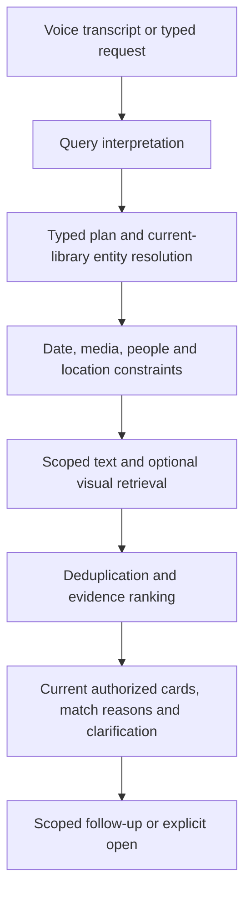

# Assistant search: findings and next implementation

Reviewed October 15 after the v60 release. **Search reliability takes priority;
new story-creation UX is deferred at the owner's request.** Existing saved
memories remain useful retrieval evidence. This review proposes search changes;
it does not enable a new model, index, route, schema or production feature.

## Confirmed diagnosis

A read-only inspection of recent receipt records confirmed successful ASR and
turn intake. Clarification/unsupported responses were successful HTTP requests,
not proof of a useful search. Private input text and household counts remain in
private diagnostic evidence, never in Git or public test fixtures.

| Layer | Confirmed behavior | Consequence |
| --- | --- | --- |
| ASR | A spoken search verb can become its homophone for taking a photo | The assistant needs a correction/clarification path, not silent rewriting |
| Command interpretation | Fixed prefixes left ordinary words such as 一下 unmatched; common 查一下/我想找/English polite wrappers were unsupported | Valid requests failed before retrieval |
| Installed media index | The inspected library enables date, reviewed locations and media only; no reviewed people/assignments | Stored captions and face data are not automatically searchable |
| Date search | Uses recorded `taken_at`; scoped videos lacked that field | A zero result does not establish that there are no videos from that period |
| Caption/text search | Discovery has a literal caption filter, but the assistant does not populate it from arbitrary content phrases | A caption existing in the database does not mean the assistant uses it |
| Saved memories | A separate negotiated workspace path literally searches saved story title/narration and memoir title/introduction | It does not join all photo notes, captions, people and visual evidence |
| Ranking | Media results sort by descending asset ID after hard filters | There is no unified semantic relevance ranking |

Code entry points: `server/backend/app/access/assistant.py`,
`discovery.py`, `discovery_provider.py`, `stories.py`,
`assistant_memory_discovery.py` and `assistant_workspace_transport.py`.
The existing protected `Stories.search` already unites photo memories, captions
and some admitted annotation sources; evaluate reuse before creating another
text-retrieval implementation. It is still literal matching and lacks the whole
combined person/date/semantic plan.

Face detection is different from identity recognition. The current reviewed
person path requires approved names/aliases and explicit manual assignments.
Do not expose raw clustering labels as confirmed identities. The assistant's
facet enumeration also stops at 500 entries although the index permits larger
rosters; replace repeated full-source reads with scoped candidate lookup before
expanding that bound.

## Implemented locally in this increment

- Shared server parsing accepts ordinary Chinese search forms, 一下/找一找,
  我想找, and bounded English polite wrappers. Entities and dates still use the
  current protected resolver; unmatched conditions are not discarded.
- Suspected 照一下/找一下 confusion requests a correction without starting a
  search or modifying the transcript.
- Clarification names unavailable people/caption/tag indexes instead of implying
  those fields are already searchable.
- Empty date results explain the capture-date basis and exclusion of unknown
  dates. They do not silently broaden a date search or substitute upload dates.
- Synthetic regressions compare canonical and conversational filters/results,
  preserve invalid/unknown/negated constraints, and cover absent indexes and
  empty dates. The new suite is included in `tools/check.py api`.

This uses the existing response/context shapes, with no route/schema/APK change.
The deployed v60 service remains unchanged until a separately authorized server
release. A sentence-parser fix alone does not complete natural-language search.

## Target retrieval architecture

### 1. Make existing evidence searchable

Build a replaceable, derived per-library search projection keyed by asset ID and
source revision. Start with currently authorized photo notes and eligible
captions; link reviewed names/aliases and manual face evidence. Later add saved
story/chapter text and approved tags/locations through the same source adapters.
Represent source type, author/edit status, revision and provenance separately.
Do not duplicate original audio, images or video in the text index.

Use existing authorization before candidate generation and revalidate current
membership, library mapping, active asset/source state and source revision before
returning/counting a result. Shared source links do not grant new access. Never
let a stale derived hit reveal a withdrawn note, deleted asset or foreign-library
person. Rebuilds and incremental changes need explicit source watermarks,
backpressure, cancellation and replay/deletion checks.

A local full-text index is a candidate, subject to native feature/runtime
qualification. Chinese tokenization and short words need their own acceptance
corpus: SQLite's trigram MATCH does not match queries shorter than three Unicode
characters. Test two-character examples such as 海边 and 妈妈; choose an explicit
short-query/tokenization strategy instead of assuming a default tokenizer gives
Chinese semantic recall. See the [SQLite FTS5 documentation](https://sqlite.org/fts5.html#the_trigram_tokenizer).
No SQLite extension or new dependency was installed for this review.

### 2. Restore useful date evidence without inventing capture dates

Prepare a bounded read-only recovery inventory for embedded video timestamps,
existing metadata and filename hints. Compare timezone/validity/source evidence
before proposing a capture-date repair. Reading a filename date alone does not
prove when footage was recorded; download/export dates may differ.

Keep `capture`, `filename` and `received` as distinct query/display bases. Default
capture-date search must explain missing coverage. Offer explicitly searching by
filename date when appropriate; do not silently classify receipts as capture
time. This requires a versioned negotiated filter/context contract and old-client
checks, not an unannounced extra JSON field. Database backfill or source metadata
writes require their own reviewed operation; none occurred in this investigation.

### 3. Understand a request as a bounded query plan

Use common deterministic forms as a fast path. Add a replaceable **Windows-local**
language-understanding adapter for richer expressions, with strict typed output:
media, date interval/basis, resolved person candidates, place, semantic phrase,
conjunction/negation and uncertainty. The backend validates every field against
current capabilities and authorized entities. The model never provides SQL,
permissions, arbitrary identifiers, file/URL access or administrative actions.

Resolve a person's name before searching. Ask about ambiguous names; model
confidence is not a face-identity grant. Per-user relationship aliases such as
妈妈 require that user's reviewed mapping; do not assign the same relative to
all accounts. Proper-name ASR hints, if supported by the qualified adapter, must
also be bounded to current authorized names. Preserve the actual transcript and
any explicit correction separately.

Preserve conjunction: 两个人一起 means both, not either. A follow-up such as 只看
九月的 must refine the current owned query/result scope. Unsupported negation,
unknown person/place or stale context requires clarification. Do not ignore those
constraints to improve apparent recall.

### 4. Rank and explain actual matches

Combine typed filters, lexical content matches and qualified semantic/visual
candidates. Prefer exact confirmed-person and family-authored evidence where
appropriate; keep AI captions labeled as generated, and do not turn ranking
weights into claims of fact. A scene phrase should not have to be an exact caption
substring. Deduplicate assets across sources before ranking and pagination.

Visual vectors must match modality, model, dimension, preprocessing and source
version. Reuse existing qualified vector/provider adapters where possible;
changing the query model does not make incompatible vectors comparable. Benchmark
quality before choosing fusion weights or a reranker. No GPU/model inference is
authorized or performed by the current read-only investigation.

Show applied filters, date basis and why each card matched: confirmed person,
recorded date, quoted family note or caption. Distinguish no matches from unknown
dates, missing index, unresolved name or unavailable provider. Speech summarizes
the current returned cards; it cannot invent matching photos or private facts.

## Ordered implementation and acceptance

1. Qualify and deliver the bounded parsing/diagnostic fix. Existing v60 clients
   need no APK update for this server response change.
2. Implement the scoped text/person projection and a generated retrieval corpus;
   assess private-library readiness before staging or activating it.
3. Qualify video date evidence and explicit filename-date search, preserving the
   original capture field until an independently approved repair.
4. Add/qualify typed local language understanding and hybrid ranking against the
   same corpus; then improve follow-up/filter explanations in Web and phone.

The corpus must cover Chinese/English paraphrases, two-character Chinese queries,
confirmed/ambiguous/unknown people, two-person conjunction, periods and leap dates,
missing/conflicting date bases, note/caption contradictions, duplicates, mixed
photo/video results, stale/deleted sources and permission changes. Measure intent
and filter accuracy, recall/precision at K, empty-result explanations and latency
separately. Family examples stay private and need a manually confirmed relevance
set; synthetic tests alone do not establish production search quality.

## Validation and delivery boundary

The focused suite has five tests with conversational and refusal subcases; nine
positive/ASR assertions failed before the fix and passed afterwards. The selected
shared assistant/asset/overview/workspace/saved-memory HTTP cohort passed 63 tests.
The 13 tooling check-driver tests also passed. Full API/Android/Web release
profiles were not rerun for this bounded source fix. These checks use generated
data and in-process ASGI, not real recordings, GPU
inference or a live Windows query. Original v60 release receipts remain valid for
their frozen source; this increment has not restarted or deployed any service.
