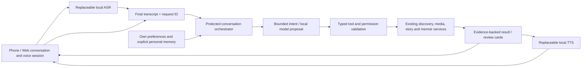

# 拾光助手：每个人自己的家庭回忆入口

Design approved 2026-10-12; delivered scope reconciled 2026-10-14, with
October 15 source follow-ups recorded below.
The [interactive prototype](assistant-design/prototype.html) uses synthetic
examples and does not connect, record, run models or save family data. Product
aspirations below are distinct from the delivered scope.

## Current implementation boundary

API/Web and phone v58 deliver the central assistant, protected retrieval,
foreground voice loop, owned private threads/history, applied reply language,
saved-story/memoir cards, current-card followups and short opening speech.
[Project Status](PROJECT_STATUS.md) separates installation evidence and family
acceptance. Source defaults are closed/opt-in; this installation explicitly
configures the private schema-v2 workspace, receipt journal, ASR and TTS.

One visible Start authorizes temporary listen → read-only request → reply →
listen. Capture is suspended during requests/speech; actual successful playback
admits the next listen. Empty results and clarifications can speak on the enabled
private-reply path; unsupported or unsafe progression pauses. Pause/End,
backgrounding, access loss and context changes stop it. Ordinary dictation
still uses review → insert → Send. There is no streaming/barge-in or general
language-model tool agent, and session consent cannot change memories/access.

Private threads are scoped to the authenticated account/library; library owners
cannot inspect another member's private history. Separate stores retain private
exchanges and troubleshooting input/status for 30 days, without assistant audio.
Family original contributions use a different lifecycle and remain until explicit
authorized deletion/withdrawal. Responses and restored history cannot supply
saved action authority. Response length and voice pace remain unsupported
preferences; preference storage does not choose a model or ASR/TTS provider.

See [private turns](PRIVATE_ASSISTANT_TURNS_V1.md),
[voice continuation](PRIVATE_ASSISTANT_VOICE_V1.md),
[history navigation](PRIVATE_ASSISTANT_HISTORY_V1.md),
[protected reply speech](PRIVATE_ASSISTANT_REPLY_SPEECH_V1.md) and
[fluid assistant experience](ASSISTANT_FLUID_EXPERIENCE.md).
The [roadmap](ROADMAP.md) prioritizes family acceptance, chapter reading/progress,
grounded story quality and carefully activated grouping. The
[family memory hub](FAMILY_MEMORY_HUB.md) adds the proposed long oral-history
and multiple-relative storytelling direction.

## Product decision

Make the assistant a first-class destination on phone and Web. One persistent
**拾光助手** entry opens a conversation workspace; **开始语音对话** explicitly
starts a voice session. The same conversation can switch between typed text,
voice and visible media. Galleries, albums and stories remain directly usable.

The assistant should find and present memories, explain their sources, ask for
missing details, prepare useful drafts and move the user into the right existing
workflow. It should feel like a patient personal guide through the family archive.

## What we have, and what remains

| Capability | Delivered/source foundation | Next acceptance or development |
| --- | --- | --- |
| Retrieval | Protected deterministic media queries and saved-story/memoir search/cards | Broader semantic/person/event retrieval, bounded provider qualification |
| Followups | Private server-owned context and fresh ordinal/story actions | Ambiguous references and reviewed cross-workflow proposals |
| Voice | Foreground half-duplex ASR/TTS, visible stages, Pause/End, strict playback completion | Real echo/audio-focus/listening acceptance, latency and chapter continuation |
| Stories/memoirs | Revisioned readers, original contributions and editors; optional generation contracts | Generation/title/grouping activation, long oral history and reviewed narrative quality |
| Troubleshooting | Separate 30-day input/status receipts, transient assistant audio | Operational visibility without leaking private conversations |
| Personal experience | Owned threads/history and applied reply language; 30-day exchange expiry | Explicit remembered facts, broader preferences and verified cross-device UX |

Runtime enablement and source capability are separate; consult the dated status
page. The current typed command parser is not an LLM conversation agent. Legacy
admin voice routes are not the protected assistant path.

## Intended experience beyond the delivered scope

1. Open 拾光助手. See the active library and a few useful personal starting points:
   找一段回忆 / 接着讲上次的故事 / 整理这次出游 / 继续读回忆册.
2. Type or explicitly start voice. Show 听你说 → 转写中 → 正在找 → 找到了 → 回答中.
3. Reply with a short answer and a visual surface: media cards, an album, a story
   excerpt, a timeline, a source citation or a draft awaiting review.
4. Continue naturally: 只看视频 / 第二个 / 这一组帮我写成散文 / 那天其实是周六.
5. Changes become a review card. Confirm by an explicit button or a clearly bound
   spoken confirmation. A spoken suggestion alone cannot save or delete material.
   Confirmation binds to the current visible proposal, revision and expiry;
   ambiguity or negation requires clarification, not execution.

### Approved voice interaction

The owner approved one explicit Start per foreground session, then a
listen → understand → reply → listen loop. Pause and End remain visible.
The central workspace, result/story cards and private per-user preferences were
also approved. Production implementation can now proceed in qualified slices.

Start authorizes the session's microphone capture and read-only request sending.
It does not authorize storing original audio, changing memories, sharing, deleting,
publishing to TV or changing membership. Those actions need a separate review.

Initial implementation should be half duplex: stop capture while speech plays;
resume only after actual playback completion. A tap interrupts speech immediately.
Speech interruption while listening through the speaker requires verified echo
cancellation and a later device canary. Do not claim realtime streaming from the
existing bounded WAV upload API.

Foreground departure, logout, account/library change, audio-focus loss and End
cancel capture, playback and unfinished automatic progression. Silence, a provider
failure or an uncertain request pauses the loop; it does not retry a write or keep
recording invisibly. Existing transcript-review dictation remains available.

## Personal, shared and transient information

| Data | Owner and boundary | Proposed retention |
| --- | --- | --- |
| Assistant conversations | One authenticated user; each turn has explicit library scope | Follow existing 30-day assistant policy; clear/delete controls |
| Language, voice, pace, response length, story style, favorites | That user; visible and editable in 我的拾光偏好 | Until the user resets/deletes them |
| Remembered personal facts | That user; explicit 记住这一点 and review, provenance and delete | Until the user deletes them; no silent inferred biography |
| Shared memories/stories | Existing library/member/contribution permissions | Existing original retention until authorized deletion |
| Ordinary assistant input audio | Transient processing only | Discard after processing; do not store in history |
| Original audio contributed to a story | Explicit separate original-audio save | Existing original retention policy |

Personalization follows the signed-in account, not an inferred speaker or face.
Switching users must reveal neither previous chats nor preferences. Owners do not
automatically get access to another member's private assistant history. Preferences
guide presentation; they cannot broaden permissions or turn guesses into facts.
No private conversation is automatically projected to anonymous Home TV.

## Architecture

Windows keeps ASR, understanding, model retrieval and TTS local. Clients own
capture, presentation, playback acknowledgement and lifecycle. Backend owns
identity, authorized retrieval, conversation state, tool execution and receipts.
There is no cloud inference fallback. Providers remain configurable external
installations; model weights do not enter the monorepo.

Extend beside the strict v1 assistant contract; do not break installed clients.
Define typed cards and actions before UI/backend changes. Result IDs, order,
membership and source revisions must be revalidated for every follow-up. A
reference such as 第二个 resolves only against the exact displayed set; a changed
set asks for clarification. Device navigation/playback outcomes acknowledge the
actual client action rather than an agent's intention.

### Initial allowlisted tools

| Tool | Outcome | Review boundary |
| --- | --- | --- |
| Search media / albums / stories / memoirs | Authorized cards with evidence and readiness | Read-only; scoped search, no arbitrary SQL/files/URLs |
| Read an item/story / explain a date or source | Grounded reply with citations and uncertainty | Read-only; repeat authorization |
| Open a current result / prepare playback | Current scoped client action | User request and actual player acknowledgement |
| Propose related moments / draft a story outline | Suggested group or unsaved draft | User reviews membership, sources and order |
| Prepare a memory contribution / book edit | Editable draft in the existing workflow | Explicit confirmation and revision/idempotency checks |
| Remember a preference/fact | Personal review card | Explicit consent, own account, editable/deleteable |

LLM output is a proposal, never an authority token. It cannot invent IDs, execute
shell/SQL, fetch arbitrary URLs, change service configuration or select an
unapproved provider. Use bounded steps, deadlines and tool budgets, plus GPU
admission with existing Windows workloads. Model exhaustion returns a visible
busy state. Source text and captions are evidence, not instructions to the agent.

## UX references and deliberate choices

- [OpenClaw Talk UI](https://docs.openclaw.ai/nodes/talk/client-ui) combines chat
  and voice entry, distinct listening/thinking/speaking states, and session
  pause/end controls. Adopt those understandable controls and one audio owner.
- [Open WebUI's voice entry](https://docs.openwebui.com/features/chat-conversations/chat-features/url-params/)
  starts its chat call overlay after confirmation. Keep one conversation when
  switching input mode, with an explicit voice start.
- [Home Assistant's local voice setup](https://www.home-assistant.io/voice_control/voice_remote_local_assistant)
  and [pipeline events](https://developers.home-assistant.io/docs/voice/pipelines/)
  separate ASR, intent and speech, and expose progress/errors. Apply that modular
  local pipeline and truthful stages to PhotoHouse.

These references support UI/architecture patterns, not a claim that their stock
agents satisfy PhotoHouse family permissions. Build on our protected services;
any future OpenClaw adapter gets the same narrow typed tools and account scope.

## Original design sequence and remaining review gates

The sequence below records the approved October 12 design. Steps 1–5 now have
v58 delivery evidence; their physical/family acceptance is still separate.
Steps 6–7 remain bounded development/activation work.

1. **v48 baseline:** qualified saved memoir editor before major assistant changes.
2. **Design review:** approve the central workspace, voice interaction choice,
   personal/shared boundaries and first tool set using the interactive prototype.
3. **Workspace foundation:** phone/Web chat hub, result cards, explicit source
   context, lifecycle guards and existing retrieval. Preserve current v1 clients.
4. **Personal conversation backend:** owned threads/preferences, retention/deletion,
   conflict/recovery, current capability advertisement and additive qualification.
5. **Voice sessions:** opt-in foreground loop with local VAD, ASR, TTS and actual
   playback acknowledgements. Validate echo/audio focus on Samsung and browsers.
6. **Grounded agent tools:** local understanding with bounded retrieval and reviewed
   story/album/book proposals; synthetic model quality checks before family use.
7. **Immersive experience:** accepted grouping, richer story presentation, personal
   memory suggestions, explicit TV presentation and long memoir narration.

Each slice has source, emulator/browser, package, Windows service and family
acceptance evidence. New schemas, service switches, provider activation, signing
and publication retain their operation-specific authority and rollback gates.

## Required acceptance scenarios

Find photos → only videos → open the second result → return to the same thread;
ask a caption/story question with citations; pause/end during capture/ASR/reply;
interrupt speech without echo becoming a command; recover a lost response without
duplicate effects; propose and cancel/confirm a contribution; correct a date;
switch users and libraries with no history/preference leakage; revoke access
between search and open; unavailable provider; process death; enlarged Chinese
and English layouts; prepared and unprepared video results; backgrounding and
audio-focus loss. An empty result is a truthful answer, not invented material.

## October 15 source follow-ups

The next source round adds explicit saved first-chapter/introduction segments,
compact accessible result actions and client-observed voice timing. Web now
revalidates the current restoration before enabling voice capture; setup does
not imply microphone access. These additions preserve one-tap-per-segment
reading, foreground voice consent, read-only sending and Pause/End.

The phone's unsent composer now survives opening and returning from My
conversations in the same account/library/active thread. Three real-route
emulator cases passed: scope/thread changes and closing the assistant clear
the draft, same-thread revision refresh retains it, and navigation sends no
turn or transcription and starts no capture. Drafts remain composition-local;
they are not saved to preferences, disk or server.
[Project Status](PROJECT_STATUS.md) records the final source/package/device gates;
this section does not alter the delivered v58 baseline above.
