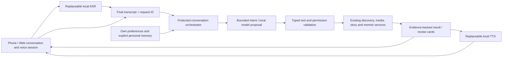

# 拾光助手：每个人自己的家庭回忆入口

Status: approved by the owner, 2026-10-12; implementation in progress. The [interactive design prototype](assistant-design/prototype.html) uses
synthetic examples. It does not record, connect to PhotoHouse,
run a model or save family data. Phone v48 is a separate delivery of the already
qualified saved memoir editor.

## Current implementation boundary

The first phone/Web source slice uses the existing protected v1 retrieval,
transcription and result-count speech. It adds a central workspace and explicit
foreground voice session; actual playback completion admits the next capture.
Provider failures, uncertainty and context changes stop automatic progression.
Clarifications and empty/unsupported replies remain visible and pause the loop.
This layer has no language-model tool agent or story-writing authority.

`assistant_workspace_store.py` separately implements private account/library
threads and revisioned account preferences with explicit initialization, fixed
30-day exchange expiry, deletion, bounded typed references and exact retry checks.
The protected `/assistant/workspace/v1` source API now exposes owned thread
listing/creation/reading/deletion and revisioned preference reading/updating/reset.
It requires fresh library membership, an explicitly configured existing store and
healthy retention maintenance. Saved references are reduced to non-actionable
type/count placeholders; IDs, bindings and receipt IDs are not projected as actions.
No client can upload an arbitrary assistant reply or card list. Capability flags
report that server-owned turns and applied preferences are not implemented yet.
The API is default-off, not deployed, and no conversation database has been created
on Windows. Client continuation and reference revalidation remain future work.
Preference storage alone does not change the current ASR/TTS/provider settings.

The [roadmap](ROADMAP.md#october-12-central-personal-assistant) records the next
layers: protected thread/preferences APIs, client continuation and preference
controls, then qualified local understanding and reviewed cross-workflow tools.
Phone v49 is published with the workspace/voice foundation; these private backend
APIs are a separate source slice and are not activated by that APK.

## Product decision

Make the assistant a first-class destination on phone and Web. One persistent
**拾光助手** entry opens a conversation workspace; **开始语音对话** explicitly
starts a voice session. The same conversation can switch between typed text,
voice and visible media. Galleries, albums and stories remain directly usable.

The assistant should find and present memories, explain their sources, ask for
missing details, prepare useful drafts and move the user into the right existing
workflow. It should feel like a patient personal guide through the family archive.

## What we have, and what remains

| Capability | Current inspected source | Required development |
| --- | --- | --- |
| Photo/video retrieval | Protected deterministic search, facets, dates, clarification and result cards | More natural semantic queries and retrieval across authorized stories/notes/albums |
| Follow-ups | Visible-result ordinal opening and scoped filter refinement | Durable conversation, unresolved references and cross-workflow context |
| Voice | Opt-in foreground voice loop in phone/Web source; endpointing, strict playback completion, Pause/End; ordinary reviewed dictation retained | Native delivery and real microphone/audio-focus/echo acceptance; richer grounded speech |
| Stories and memoirs | Separate revisioned readers, contribution/editor/chat APIs | Assistant tools that hand off or propose changes in those authorized workflows |
| Troubleshooting | Account/library-scoped receipts, recognized text and status, 30-day retention | Conversation context distinct from audit receipts; user-visible processing stages |
| Personal experience | Default-off, tested owned thread/preferences APIs and isolated storage, inactive at runtime | Server-owned turns, client continuation, applied preferences, explicit remembered facts and cross-device continuation |

These are source facts, not current service or family-device acceptance. The
protected assistant's narrow command parser is not an LLM conversation agent.
Legacy admin voice routes are not the current protected assistant path.

## Experience

1. Open 拾光助手. See the active library and a few useful personal starting points:
   找一段回忆 / 接着讲上次的故事 / 整理这次出游 / 继续读回忆册.
2. Type or explicitly start voice. Show 听你说 → 转写中 → 正在找 → 找到了 → 回答中.
3. Reply with a short answer and a visual surface: media cards, an album, a story
   excerpt, a timeline, a source citation or a draft awaiting review.
4. Continue naturally: 只看视频 / 第二个 / 这一组帮我写成散文 / 那天其实是周六.
5. Changes become a review card. Confirm by an explicit button or a clearly bound
   spoken confirmation. A spoken suggestion alone cannot save or delete material.
   Confirmation binds to the current visible proposal, revision and expiry;
   ambiguity or negation requires clarification, not execution.

### Approved voice interaction

The owner approved one explicit Start per foreground session, then a
listen → understand → reply → listen loop. Pause and End remain visible.
The central workspace, result/story cards and private per-user preferences were
also approved. Production implementation can now proceed in qualified slices.

Start authorizes the session's microphone capture and read-only request sending.
It does not authorize storing original audio, changing memories, sharing, deleting,
publishing to TV or changing membership. Those actions need a separate review.

Initial implementation should be half duplex: stop capture while speech plays;
resume only after actual playback completion. A tap interrupts speech immediately.
Speech interruption while listening through the speaker requires verified echo
cancellation and a later device canary. Do not claim realtime streaming from the
existing bounded WAV upload API.

Foreground departure, logout, account/library change, audio-focus loss and End
cancel capture, playback and unfinished automatic progression. Silence, a provider
failure or an uncertain request pauses the loop; it does not retry a write or keep
recording invisibly. Existing transcript-review dictation remains available.

## Personal, shared and transient information

| Data | Owner and boundary | Proposed retention |
| --- | --- | --- |
| Assistant conversations | One authenticated user; each turn has explicit library scope | Follow existing 30-day assistant policy; clear/delete controls |
| Language, voice, pace, response length, story style, favorites | That user; visible and editable in 我的拾光偏好 | Until the user resets/deletes them |
| Remembered personal facts | That user; explicit 记住这一点 and review, provenance and delete | Until the user deletes them; no silent inferred biography |
| Shared memories/stories | Existing library/member/contribution permissions | Existing original retention until authorized deletion |
| Ordinary assistant input audio | Transient processing only | Discard after processing; do not store in history |
| Original audio contributed to a story | Explicit separate original-audio save | Existing original retention policy |

Personalization follows the signed-in account, not an inferred speaker or face.
Switching users must reveal neither previous chats nor preferences. Owners do not
automatically get access to another member's private assistant history. Preferences
guide presentation; they cannot broaden permissions or turn guesses into facts.
No private conversation is automatically projected to anonymous Home TV.

## Architecture

Windows keeps ASR, understanding, model retrieval and TTS local. Clients own
capture, presentation, playback acknowledgement and lifecycle. Backend owns
identity, authorized retrieval, conversation state, tool execution and receipts.
There is no cloud inference fallback. Providers remain configurable external
installations; model weights do not enter the monorepo.

Extend beside the strict v1 assistant contract; do not break installed clients.
Define typed cards and actions before UI/backend changes. Result IDs, order,
membership and source revisions must be revalidated for every follow-up. A
reference such as 第二个 resolves only against the exact displayed set; a changed
set asks for clarification. Device navigation/playback outcomes acknowledge the
actual client action rather than an agent's intention.

### Initial allowlisted tools

| Tool | Outcome | Review boundary |
| --- | --- | --- |
| Search media / albums / stories / memoirs | Authorized cards with evidence and readiness | Read-only; scoped search, no arbitrary SQL/files/URLs |
| Read an item/story / explain a date or source | Grounded reply with citations and uncertainty | Read-only; repeat authorization |
| Open a current result / prepare playback | Current scoped client action | User request and actual player acknowledgement |
| Propose related moments / draft a story outline | Suggested group or unsaved draft | User reviews membership, sources and order |
| Prepare a memory contribution / book edit | Editable draft in the existing workflow | Explicit confirmation and revision/idempotency checks |
| Remember a preference/fact | Personal review card | Explicit consent, own account, editable/deleteable |

LLM output is a proposal, never an authority token. It cannot invent IDs, execute
shell/SQL, fetch arbitrary URLs, change service configuration or select an
unapproved provider. Use bounded steps, deadlines and tool budgets, plus GPU
admission with existing Windows workloads. Model exhaustion returns a visible
busy state. Source text and captions are evidence, not instructions to the agent.

## UX references and deliberate choices

- [OpenClaw Talk UI](https://docs.openclaw.ai/nodes/talk/client-ui) combines chat
  and voice entry, distinct listening/thinking/speaking states, and session
  pause/end controls. Adopt those understandable controls and one audio owner.
- [Open WebUI's voice entry](https://docs.openwebui.com/features/chat-conversations/chat-features/url-params/)
  starts its chat call overlay after confirmation. Keep one conversation when
  switching input mode, with an explicit voice start.
- [Home Assistant's local voice setup](https://www.home-assistant.io/voice_control/voice_remote_local_assistant)
  and [pipeline events](https://developers.home-assistant.io/docs/voice/pipelines/)
  separate ASR, intent and speech, and expose progress/errors. Apply that modular
  local pipeline and truthful stages to PhotoHouse.

These references support UI/architecture patterns, not a claim that their stock
agents satisfy PhotoHouse family permissions. Build on our protected services;
any future OpenClaw adapter gets the same narrow typed tools and account scope.

## Delivery sequence and review gates

1. **v48:** deliver the qualified saved memoir editor. No major agent changes.
2. **Design review:** approve the central workspace, voice interaction choice,
   personal/shared boundaries and first tool set using the interactive prototype.
3. **Workspace foundation:** phone/Web chat hub, result cards, explicit source
   context, lifecycle guards and existing retrieval. Preserve current v1 clients.
4. **Personal conversation backend:** owned threads/preferences, retention/deletion,
   conflict/recovery, current capability advertisement and additive qualification.
5. **Voice sessions:** opt-in foreground loop with local VAD, ASR, TTS and actual
   playback acknowledgements. Validate echo/audio focus on Samsung and browsers.
6. **Grounded agent tools:** local understanding with bounded retrieval and reviewed
   story/album/book proposals; synthetic model quality checks before family use.
7. **Immersive experience:** accepted grouping, richer story presentation, personal
   memory suggestions, explicit TV presentation and long memoir narration.

Each slice has source, emulator/browser, package, Windows service and family
acceptance evidence. New schemas, service switches, provider activation, signing
and publication retain their operation-specific authority and rollback gates.

## Required acceptance scenarios

Find photos → only videos → open the second result → return to the same thread;
ask a caption/story question with citations; pause/end during capture/ASR/reply;
interrupt speech without echo becoming a command; recover a lost response without
duplicate effects; propose and cancel/confirm a contribution; correct a date;
switch users and libraries with no history/preference leakage; revoke access
between search and open; unavailable provider; process death; enlarged Chinese
and English layouts; prepared and unprepared video results; backgrounding and
audio-focus loss. An empty result is a truthful answer, not invented material.
