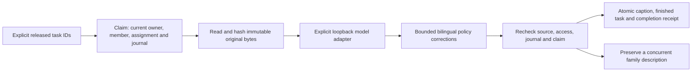

# Receipt-selected upload captions

This is an **offline source candidate**, separate from the legacy broad caption
launcher. It does not register a scheduled task, start the model service, migrate
any database, enable a route or select unfinished work from the global queue.

## Request and transaction boundaries



`upload_caption_processing` accepts only caption starters listed in a persisted,
digest-verified `release_deferred_upload_starters` receipt. The original database
identity and selected operator/library must still match. Each claim and final
write uses the configured `ExistingDatabase` and original-deletion journal.
Neither a file receipt nor membership alone can select arbitrary tasks.

Only a due, uncancelled pending task with fewer than three attempts can be
claimed. The claim carries a unique marker. Inference runs outside the writer
reservation on bounded, hash-verified source bytes. Before publication, the worker
rechecks the source hash/identity, owner, uploader, active single-library mapping,
cancellation, journal and marker. A completed or failed job is never reset.
A deterministic completion receipt also prevents duplicate generation if someone
later changes a finished task back to pending.

Any existing caption is preserved. A family description added while inference is
running wins; the generated result is discarded. This first lane fills missing
captions. It does not refresh variants, name people, write stories, adopt tags or
copy family prose into other assets.

## Provider and model identity

The provider is explicitly constructed; there is no settings discovery, cloud
fallback, stub result or model download. `LocalCaptionHTTP` permits an explicit
loopback HTTP address/port, disables environment proxies and redirects, and
requires a healthy loaded Qwen3-VL provider before admission. Each caption and
translation response must also match `expected_model_id`; provider/model drift
invalidates admission. Health alone does not verify checkpoint bytes or quality.

The client reuses the shared bilingual prompt and caption policy, neutral wording,
truncation and correction rules. At most two corrections follow an initial visual
request; the first Chinese-only correction can use text translation. Text, PNG
uploads and response bodies have separate limits. Responses cannot use compressed
content to bypass the response-size limit. Errors contain fixed codes, not model
output, private paths or transport response bodies.

The generic prompt is preserved byte-for-byte from the original server source
`0d8b9f66424a6a62b9b1f4c3cea7e6a70bb15316`, path
`config/detailed-caption-prompt.txt`. The curated initial import omitted this
required resource; the caption package now includes it explicitly.

## Worker use

Construct a private JSON configuration with these exact fields:

```json
{
  "database": "/private/runtime/main.sqlite",
  "originals_root": "/private/runtime/originals",
  "original_deletion_journal_path": "/private/journals/deletions.sqlite",
  "original_deletion_namespace": "00000000-0000-4000-8000-000000000001",
  "operator_account_id": "00000000-0000-4000-8000-000000000002",
  "library_id": "reviewed-library",
  "release_plan_id": "00000000-0000-4000-8000-000000000003",
  "task_ids": [701],
  "caption_url": "http://127.0.0.1:8102",
  "expected_model_id": "Qwen/Qwen3-VL-8B-Instruct",
  "stop_file": "/private/operations/caption.stop",
  "provider_timeout_seconds": 60
}
```

These are invented placeholders, not a production configuration. Select actual
absolute native paths on Windows and the already reviewed model ID. Do not copy
household configuration into Git. Metadata preflight is portable:

```sh
python server/scripts/run_released_caption_worker.py --config /private/worker.json
```

It checks the journal and current selected task scope without reading media,
contacting a provider, claiming work or creating a report. Execution is Windows
only and requires explicit operation authority:

```sh
python server/scripts/run_released_caption_worker.py --config /private/worker.json \
  --execute --report /private/operations/new-run.json
```

The supervisor processes only the listed tasks, serially, with one fresh Job per
item: 2 GiB CPU-process-tree memory, eight processes, five minutes per item and an
8 GiB free-RAM admission floor. The total supervisor allowance is two hours;
configuration and report ownership are rechecked between items. The child verifies
explicit Job membership and policy before opening the database. The supervisor
holds a query-only, non-inheritable Job handle and provides its process identity
and handle coordinates. The child obtains a query-only duplicate on demand,
checks supervisor identity, membership and limits, then closes the temporary
handles before database work. A NULL-handle query must not stand in for the
selected Job under an SSH/launcher job hierarchy. No query handle is inherited
during Python startup. The separately operated
model server's GPU/RAM are **not** covered by the CPU client's Job.

A stop file prevents new calls/claims and result publication. It cannot cancel a
model request that has already reached the service. An unavailable provider fails
admission before consuming a task attempt. Transient generation failures schedule
bounded retries; validation/scope/source failures remain failed evidence. A killed
child can leave an owned running task: inspect its report and establish that its
process has stopped before preparing an explicit recovery. Age alone grants no
recovery authority. Never start the incompatible legacy worker to clear it.

`attempts_finished` describes this invocation, while `all_selected_finished`
separately reports whether its selected tasks actually finished. Pending backoff,
failed and interrupted tasks are not called ready. Finished caption tasks do not
prove preview/playback availability, face identity accuracy or family acceptance.

## Qualification and packaging

The generated-only qualifier accepts a new private output folder and no database,
provider or media inputs:

```sh
python server/scripts/qualify_released_caption_worker.py --out /private/new-fixture
python server/scripts/build_released_caption_package.py --commit FULL_COMMIT \
  --out /private/new-caption-source.zip
```

Its HTTP transport is synthetic; it opens no production store and loads no model.
The source package includes the reviewed guarded-runtime dependency closure and
prompt, with a fixed allowlist and per-file hashes. API source in that closure is
not API startup or deployment. Dependencies, private config, weights and media
are not included. Qualify the extracted package on Windows before preparing a
separate provider recovery or live scoped processing operation. Local tests are
not native resource, real inference or family-quality acceptance.

The first Windows attempt staged and verified the source closure but refused
before creating its synthetic database: its implicit Job lookup observed a
different Job with no configured memory/process limit. A bounded metadata-only
diagnostic reproduced the refusal. The following explicit-handle source fix
requires a newly pinned native qualification; the failed attempt is not a pass.
The existing candidate and one-shot claims remain retained evidence. See
[Microsoft's Job query contract](https://learn.microsoft.com/en-us/windows/win32/api/jobapi2/nf-jobapi2-queryinformationjobobject)
and [nested Job rules](https://learn.microsoft.com/en-us/windows/win32/procthread/nested-jobs).
